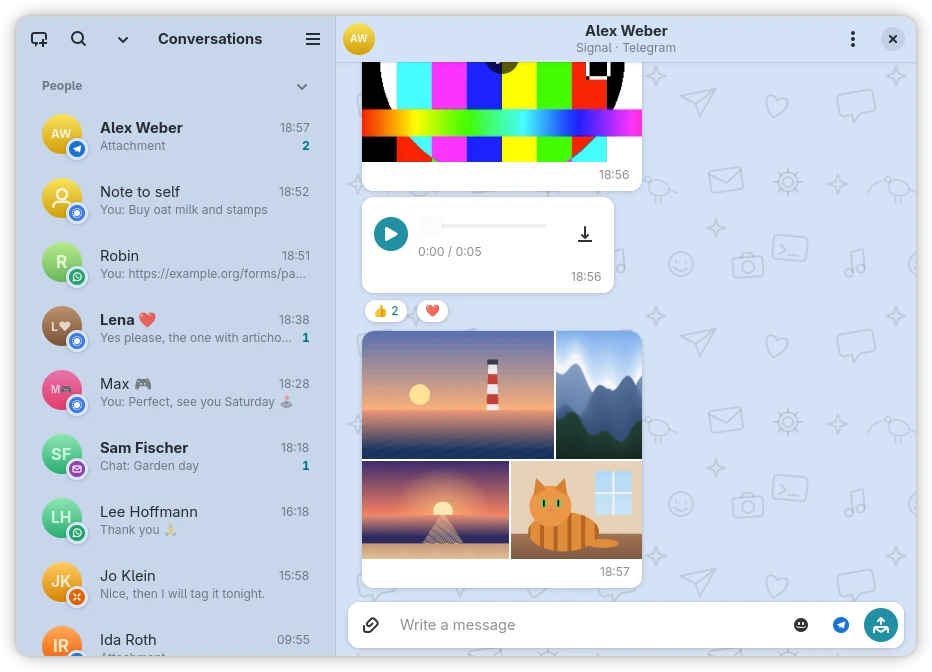

Manche schreiben mir über Signal, andere über Telegram, WhatsApp, Matrix oder per Mail, und ein
paar nehmen je nach Tag drei davon. Vor zwanzig Jahren hat [Pidgin](https://pidgin.im/) das für ICQ,
AIM und Jabber gelöst: ein Fenster für alle Netze. [Curlew](https://jumplink.eu/curlew/de/) bringt
diese Idee zu den Messengern von heute, als moderne GNOME-App, die auch auf einem Handybildschirm
funktioniert.

Heute erscheint Version 0.2.0, die erste öffentliche Version. Die Downloads liegen auf der
[App-Seite](https://jumplink.eu/curlew/de/).

## Was Curlew kann

- **Eine Liste** für Mail, Matrix, XMPP, Signal, Telegram und WhatsApp. Wen du über mehrere
  Messenger erreichst, ist ein Kontakt, mit einem Standard-Messenger, den du ändern kannst.
- **Bilder, Videos, Sprachnachrichten und Dateien** in beide Richtungen, auf jedem Protokoll gleich,
  mit Reaktionen, Bearbeiten, Löschen und Antworten, wo der Chat das kann.
- **Eine Suche** über alle Chats und Mails.
- **E-Mail-Chats:** Mail-Verläufe mit dem Header `Chat-Version` erscheinen als Chats im Stil von
  [Delta Chat](https://delta.chat/).
- **Ein Hintergrunddienst** empfängt weiter, wenn das Fenster zu ist. So verlieren Signal und
  WhatsApp, die kein Archiv auf dem Server haben, keine Nachricht.
- **Alles im Fenster.** Ein Willkommensbildschirm führt durch Protokolle und Konten; nichts braucht
  die Kommandozeile.

## Deine Nachrichten bleiben bei dir

Curlew hält seinen Index auf deinem Rechner. KI-Assistenten können über einen
[MCP](https://modelcontextprotocol.io)-Server mit deinen Nachrichten arbeiten, aber erst, wenn du das
einschaltest, und dann nur für die Konten und Kontakte, die du freigibst. KI und Lesebestätigungen
sind anfangs aus.

## Noch früh

Das ist eine frühe Version, und das merkt man an manchen Stellen:

- Gruppen in Signal, WhatsApp und XMPP lassen sich lesen, aber noch nicht beschreiben. In Telegram-
  und Matrix-Gruppen geht das schon.
- Matrix sendet nur in unverschlüsselte Räume; verschlüsselte Räume werden gelesen.
- WhatsApp und Signal laufen über inoffizielle Clients. Curlew zeigt deren Bedingungen, bevor du sie
  einschaltest.
- Linux kommt zuerst (Flatpak, `.deb`, `.rpm`). Die Versionen für macOS und Windows sind eine
  Vorschau, nur mit Chats.

## Was als Nächstes kommt

- In Gruppen auf jedem Protokoll schreiben
- Ein Bereich *Ungelesen* zum Abarbeiten und Favoriten mit Stern
- Chats und Personen stummschalten, abgeglichen mit dem Messenger
- Erwähnungen, die dich auch in einer stummen Gruppe erreichen
- Sprachnachrichten direkt im Eingabefeld aufnehmen
- Gesendete Bilder, die sofort erscheinen, bevor der Server sie bestätigt
- Später: Anrufe

## Warum ein Brachvogel

Pidgin, der Messenger, den ich jahrelang gern benutzt habe, hatte eine Taube als Maskottchen.
Curlew folgt ihr mit einem anderen Vogel: dem Großen Brachvogel, englisch *Curlew*, mit seinem
langen, gebogenen Schnabel. Den finde ich süß, und er gibt dem Icon ein klares Merkmal. Sein Ruf
trägt weit über Moore und Watt, und weite Rufe fand ich passend für einen Messenger, der viele
Protokolle spricht.

## Unter der Haube

Curlew ist in TypeScript mit GTK 4 und libadwaita geschrieben und läuft auf GJS, gebaut mit
[gjsify](https://gjsify.org/gjsify/). Unter macOS und Windows läuft derselbe Code über
`@gjsify/node-gi` auf Node.js. Der Quellcode liegt unter der AGPL auf
[GitHub](https://github.com/JumpLink/curlew).

Wenn du es ausprobierst, freue ich mich über Rückmeldung, am liebsten als
[Issue auf GitHub](https://github.com/JumpLink/curlew/issues).
