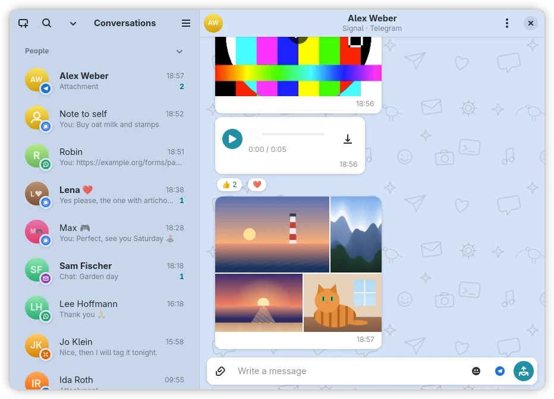

Some people write to me on Signal, others on Telegram, WhatsApp, Matrix or by mail, and a few of
them use three of those depending on the day. Twenty years ago [Pidgin](https://pidgin.im/) solved
this for ICQ, AIM and Jabber: one window, every network. [Curlew](https://jumplink.eu/curlew/en/)
brings that idea to today's messengers, as a modern GNOME app that also works on a phone-sized
screen.

Version 0.2.0 is out today, the first public release. Downloads are on the
[app page](https://jumplink.eu/curlew/en/).

## What it does

- **One list** for mail, Matrix, XMPP, Signal, Telegram and WhatsApp. A person you reach on several
  messengers is one contact, with a default messenger you can change.
- **Pictures, videos, voice messages and files** in both directions, the same way on every protocol,
  with reactions, edits, deletions and replies where the chat supports them.
- **One search** across all chats and mail.
- **Email chats:** mail threads that carry the `Chat-Version` header show as chats in the style of
  [Delta Chat](https://delta.chat/).
- **A background service** keeps receiving while the window is closed, so Signal and WhatsApp, which
  keep no archive on the server, don't lose a message.
- **Everything in the window.** A welcome screen walks through protocols and accounts; nothing needs
  the command line.

## Your messages stay yours

Curlew keeps its index on your machine. AI assistants can work with your messages through an
[MCP](https://modelcontextprotocol.io) server, but only after you turn that on, and then only for the
accounts and contacts you allow. AI and read receipts are off by default.

## Early days

This is an early version, and some edges show:

- Signal, WhatsApp and XMPP groups can be read but not written to yet. Telegram and Matrix groups can.
- Matrix sends into unencrypted rooms only; encrypted rooms are read.
- WhatsApp and Signal access goes through unofficial clients. Curlew shows their terms before you
  turn them on.
- Linux comes first (Flatpak, `.deb`, `.rpm`). macOS and Windows builds are a preview with chat only.

## What's next

- Writing in group chats on every protocol
- An *Unread* section to work through, and favourites marked with a star
- Muting chats and people, synced with the messenger
- Mentions that reach you even in a muted group
- Recording voice messages right in the composer
- Sent pictures that show at once, before the server confirms them
- Later: calls

## Why a curlew

Pidgin, the messenger I used for years, had a pigeon as its mascot. Curlew follows it with another
bird: the curlew, with its long curved beak, which I find endearing and which makes a clear mark
for an icon. Its call carries far across moors and mudflats, and a call that reaches far felt like
the right image for a messenger that speaks many protocols.

## Under the hood

Curlew is written in TypeScript with GTK 4 and libadwaita and runs on GJS, built with
[gjsify](https://gjsify.org/gjsify/). On macOS and Windows the same code runs on Node.js through
`@gjsify/node-gi`. The source is on [GitHub](https://github.com/JumpLink/curlew) under the AGPL.

If you try it, I'd like to hear how it goes, best as an
[issue on GitHub](https://github.com/JumpLink/curlew/issues).
