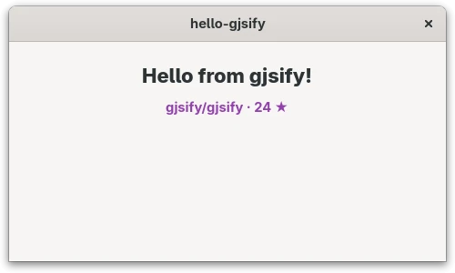

[gjsify](https://gjsify.org/) bringt die Web- und Node.js-APIs nach GJS. So sieht das in der Praxis
aus: eine kleine GTK-4-App in TypeScript, Blueprint und CSS, die Daten mit `fetch` lädt und mit
`node:fs` speichert. Installiere vorher die
[CLI](https://gjsify.org/gjsify/getting-started/), zum Beispiel mit `npm install -g @gjsify/cli`.

## Anlegen und starten

```sh
gjsify create hello-gjsify --template gtk-minimal --install
cd hello-gjsify
gjsify run build
gjsify run start
```

Du bekommst ein Fenster, eine Blueprint-Datei für die Oberfläche (`src/main-window.blp`) und eine
TypeScript-Klasse, die daran gebunden ist. Lass `gjsify dev` in einem zweiten Terminal laufen: Es
baut und startet die App bei jedem Speichern neu. Ändere die Begrüßung in der `.blp` und sieh zu,
wie sie sich aktualisiert.

## Web-Standards und Node.js nutzen

Ersetze `src/main-window.ts` durch das Folgende. Es holt Daten aus dem Web, legt sie über Nodes
Dateisystem-API ab, liest sie wieder ein und zeigt sie im Label `hint`:

```ts
import GObject from 'gi://GObject?version=2.0';
import Gtk from 'gi://Gtk?version=4.0';
import { mkdtemp, readFile, writeFile } from 'node:fs/promises';
import { tmpdir } from 'node:os';
import { join } from 'node:path';
import Template from './main-window.blp';

export class MainWindow extends Gtk.ApplicationWindow {
    declare private _hint: Gtk.Label;

    static {
        GObject.registerClass(
            {
                GTypeName: 'MainWindow',
                Template,
                InternalChildren: ['hint'],
            },
            this,
        );
    }

    constructor(application: Gtk.Application) {
        super({ application });
        void this.load();
    }

    async load(): Promise<void> {
        const response = await fetch('https://api.github.com/repos/gjsify/gjsify', {
            signal: AbortSignal.timeout(10_000),
        });
        const file = join(await mkdtemp(join(tmpdir(), 'gjsify-')), 'repo.json');
        await writeFile(file, await response.text());
        const { full_name, stargazers_count } = JSON.parse(await readFile(file, 'utf8'));
        this._hint.set_label(`${full_name} · ${stargazers_count} ★`);
    }
}
```

`fetch` und `AbortSignal` funktionieren wie im Browser, `node:fs`, `node:os` und `node:path` wie in
Node.js. Darunter laufen sie auf Soup, Gio und GLib: keine Browser-Engine, kein Node.js-Prozess.

## Gestalten

Lege das CSS in eine eigene Datei, `src/style.css`:

```css
.demo-status {
  color: #9141ac;
  font-weight: bold;
}
```

gjsify macht aus einem CSS-Import einen String. TypeScript weiß das noch nicht und würde
`Cannot find module './style.css'` melden, deshalb deklarierst du es in `src/css.d.ts`:

```ts
declare module '*.css' {
    const css: string;
    export default css;
}
```

Lade den String in `src/index.ts` in einen `Gtk.CssProvider`. Tu das innerhalb des
`activate`-Handlers: Davor gibt es noch kein Display, und `Gdk.Display.get_default()` liefert
`null`. Hier die komplette Datei:

```ts
import Gtk from 'gi://Gtk?version=4.0';
import Gio from 'gi://Gio?version=2.0';
import Gdk from 'gi://Gdk?version=4.0';
import { MainWindow } from './main-window.js';
import css from './style.css';

const app = new Gtk.Application({
    applicationId: 'org.gjsify.hello-gjsify',
    flags: Gio.ApplicationFlags.FLAGS_NONE,
});

app.connect('activate', () => {
    const provider = new Gtk.CssProvider();
    provider.load_from_string(css);
    Gtk.StyleContext.add_provider_for_display(
        Gdk.Display.get_default()!,
        provider,
        Gtk.STYLE_PROVIDER_PRIORITY_APPLICATION,
    );

    new MainWindow(app).present();
});

app.run([]);
```

Zum Schluss gibst du dem Label die Klasse in `src/main-window.blp`. Das ist die komplette Datei
mit der Änderung am zweiten Label:

```blp
using Gtk 4.0;

template $MainWindow: Gtk.ApplicationWindow {
  title: "hello-gjsify";
  default-width: 480;
  default-height: 280;

  child: Gtk.Box {
    orientation: vertical;
    spacing: 12;
    margin-top: 24;
    margin-bottom: 24;
    margin-start: 24;
    margin-end: 24;

    Gtk.Label {
      label: _("Hello from gjsify!");
      styles ["title-2"]
    }

    Gtk.Label hint {
      xalign: 0.5;
      styles ["demo-status"]
    }
  };
}
```



## Ein größeres Beispiel

[Learn 6502 Assembly](https://github.com/JumpLink/easy6502) ist genauso gebaut, mit TypeScript,
Blueprint, libadwaita und gjsify. Der Code zeigt, wie eine echte App zusammengesetzt ist.
