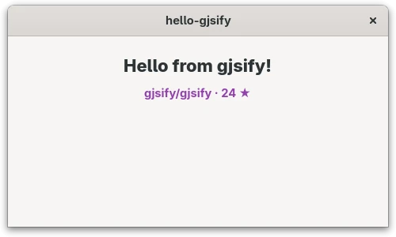

[gjsify](https://gjsify.org/) brings the web and Node.js APIs to GJS. Here is what that looks like
in practice: a small GTK 4 app in TypeScript, Blueprint and CSS that loads data with `fetch` and
stores it with `node:fs`. Install the [CLI](https://gjsify.org/gjsify/getting-started/) first, for
example with `npm install -g @gjsify/cli`.

## Create and run

```sh
gjsify create hello-gjsify --template gtk-minimal --install
cd hello-gjsify
gjsify run build
gjsify run start
```

You get a window, a Blueprint file for the interface (`src/main-window.blp`) and a TypeScript class
that binds to it. Leave `gjsify dev` running in a second terminal: it rebuilds and relaunches the app
whenever you save. Change the greeting in the `.blp` and watch it update.

## Use web standards and Node.js

Replace `src/main-window.ts` with the following. It fetches data from the web, stores it through
Node's file system API, reads it back and shows it in the `hint` label:

```ts
import GObject from 'gi://GObject?version=2.0';
import Gtk from 'gi://Gtk?version=4.0';
import { mkdtemp, readFile, writeFile } from 'node:fs/promises';
import { tmpdir } from 'node:os';
import { join } from 'node:path';
import Template from './main-window.blp';

export class MainWindow extends Gtk.ApplicationWindow {
    declare private _hint: Gtk.Label;

    static {
        GObject.registerClass(
            {
                GTypeName: 'MainWindow',
                Template,
                InternalChildren: ['hint'],
            },
            this,
        );
    }

    constructor(application: Gtk.Application) {
        super({ application });
        void this.load();
    }

    async load(): Promise<void> {
        const response = await fetch('https://api.github.com/repos/gjsify/gjsify', {
            signal: AbortSignal.timeout(10_000),
        });
        const file = join(await mkdtemp(join(tmpdir(), 'gjsify-')), 'repo.json');
        await writeFile(file, await response.text());
        const { full_name, stargazers_count } = JSON.parse(await readFile(file, 'utf8'));
        this._hint.set_label(`${full_name} · ${stargazers_count} ★`);
    }
}
```

`fetch` and `AbortSignal` work as in the browser, `node:fs`, `node:os` and `node:path` as in Node.js.
Under the hood they run on Soup, Gio and GLib: no browser engine, no Node.js process.

## Style it

Put the CSS in its own file, `src/style.css`:

```css
.demo-status {
  color: #9141ac;
  font-weight: bold;
}
```

gjsify turns a CSS import into a string. TypeScript does not know that yet and would report
`Cannot find module './style.css'`, so declare it in `src/css.d.ts`:

```ts
declare module '*.css' {
    const css: string;
    export default css;
}
```

Load the string into a `Gtk.CssProvider` in `src/index.ts`. Do it inside the `activate` handler:
before that, there is no display yet and `Gdk.Display.get_default()` returns `null`. Here is the
complete file:

```ts
import Gtk from 'gi://Gtk?version=4.0';
import Gio from 'gi://Gio?version=2.0';
import Gdk from 'gi://Gdk?version=4.0';
import { MainWindow } from './main-window.js';
import css from './style.css';

const app = new Gtk.Application({
    applicationId: 'org.gjsify.hello-gjsify',
    flags: Gio.ApplicationFlags.FLAGS_NONE,
});

app.connect('activate', () => {
    const provider = new Gtk.CssProvider();
    provider.load_from_string(css);
    Gtk.StyleContext.add_provider_for_display(
        Gdk.Display.get_default()!,
        provider,
        Gtk.STYLE_PROVIDER_PRIORITY_APPLICATION,
    );

    new MainWindow(app).present();
});

app.run([]);
```

Finally, give the label the class in `src/main-window.blp`. This is the complete file with the
change in the second label:

```blp
using Gtk 4.0;

template $MainWindow: Gtk.ApplicationWindow {
  title: "hello-gjsify";
  default-width: 480;
  default-height: 280;

  child: Gtk.Box {
    orientation: vertical;
    spacing: 12;
    margin-top: 24;
    margin-bottom: 24;
    margin-start: 24;
    margin-end: 24;

    Gtk.Label {
      label: _("Hello from gjsify!");
      styles ["title-2"]
    }

    Gtk.Label hint {
      xalign: 0.5;
      styles ["demo-status"]
    }
  };
}
```



## A bigger example

[Learn 6502 Assembly](https://github.com/JumpLink/easy6502) is built the same way, with TypeScript,
Blueprint, libadwaita and gjsify. Its code shows how a real app is put together.
