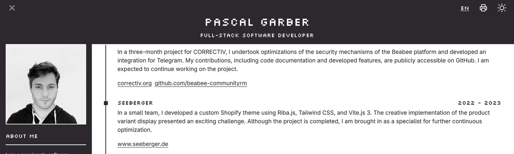

It was time for a redesign again. The old design had become too grey, too heavy on text and out of
date:

## The look

I did not want to give up the pixel-art look, but I wanted more colour and more life on the page. I
live in Cuxhaven, so every page opens with the view from the dike: sky, sea and, on the horizon,
the Kugelbake, the town's landmark beacon. If your system is set to dark mode it is evening, with
moon and stars; otherwise it is day.

The scene moves. The waves roll, container ships, fishing cutters and gulls pass by during the day,
shooting stars and aircraft at night. If you asked your system for less motion, you get a calm
still picture instead.

On the home page I stand in front of the water myself, as a pixel figure. It was made with AI, but
locally on my own computer: with ComfyUI, the FLUX.2 Klein 4B model and the
`pixel-art-sprite_limbicnation` LoRA.

Everything else stays calm: text stands free on the background with hardly any boxes, set in
Adwaita Sans, GNOME's typeface. The only pixel font left is the one for my name in the sky. A few
words are borrowed from the RPGs I like: the CV lists quests and items, the skills form a small
skill tree, and the blog is the Logbook.

By the way, a small hint: click the moon or the sun to switch between day and night. Maybe a few
more little gimmicks will turn up over time. :)

The site sets no cookies, has no tracking and loads nothing from other servers. The old site is
kept in the repository under the tag `v2-riba`.
